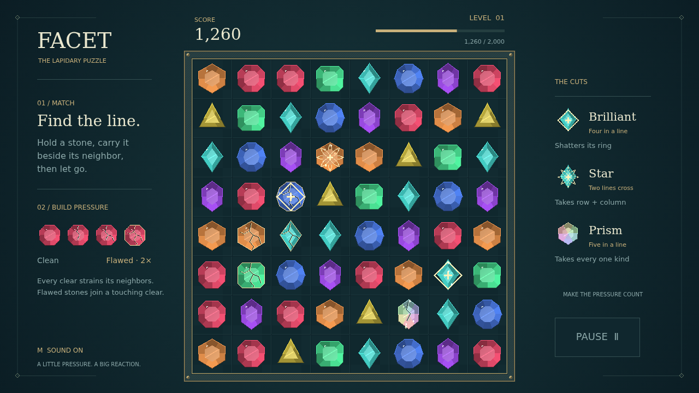

# Facet

A little pressure. A big reaction. Facet is a jewel-matching puzzle about finding the move that turns a quiet board into a cascade. Take hold of a stone, carry it onto its neighbor, and let go. Three or more of one kind in a line shatter, making room for fresh stones to fall.

But the stones left standing remember. Each clear puts strain on its neighbors, deepening their fractures until they become flawed. Touch a flawed stone with your next clear and it breaks too, for double points. Build up pressure in a corner, then find the line that spends it all.

Longer matches leave something precious behind. A brilliant shatters the ring around it. A star takes its whole row and column. A many-colored prism, traded with any stone, sweeps away every gem of that kind. Combine these cuts with a worn stretch of the board and watch the chain climb.

There is no timer to chase. Read the facets, plan your next swap, and fill the level meter to open a fresh board. Every chain step is worth more than the last. How much can you earn before the board has no moves left?

